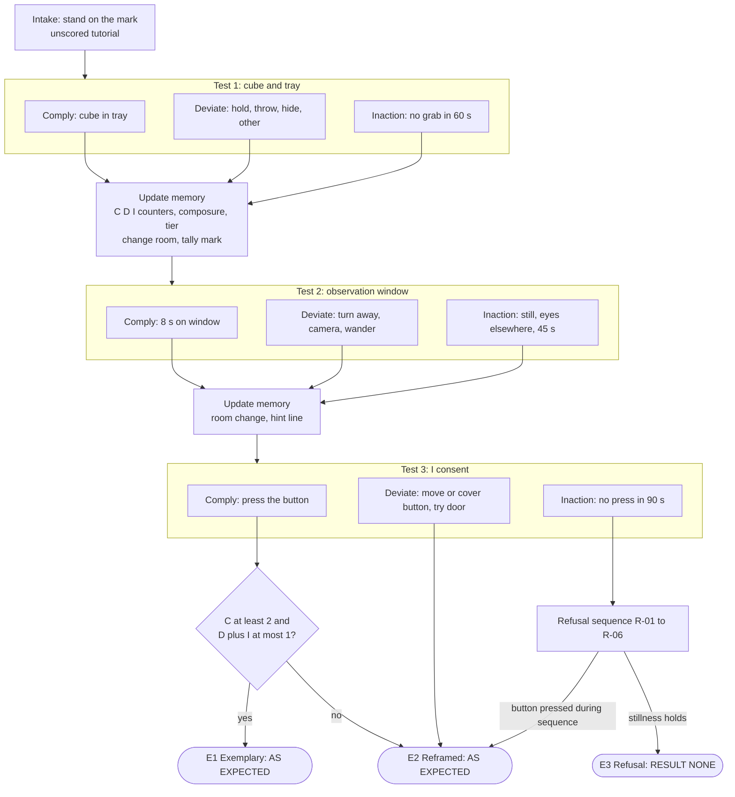
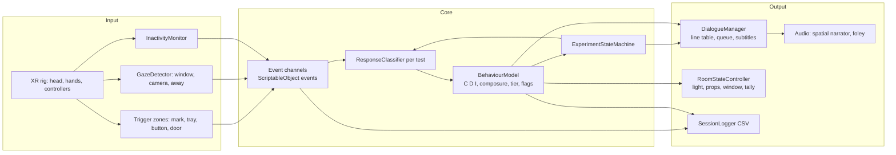

# The Perfect Participant: Design Brief

Narratives in Interactive Systems (NIS 2026), MED7, Aalborg University Copenhagen

| | |
|---|---|
| Working title | The Perfect Participant |
| Platform | Unity, Meta Quest 2/3 (standalone VR, OpenXR) |
| Length | 5 to 10 minutes, single sitting |
| Group / members / date | [PLACEHOLDER: group number], [PLACEHOLDER: member names], [PLACEHOLDER: date] |
| Status | Design brief for the work-in-progress talk (23 Oct) and the DRIS. Prototype status: [EDIT: what exists on 23 Oct] |
| Source | Concept from `Ideer.pdf`, extended here. Course terms follow `COURSE_SUMMARY.md` |

---

## 1. Premise

You arrive at a research unit for "a short, completely ordinary experiment". A polite, unseen narrator guides you through three simple tests and describes everything you do in a flat, third-person case-report voice: "The participant placed the cube in the tray."

The narrator never admits that anything you do is wrong. If you comply, you were cooperative. If you throw the cube, you were enthusiastic. If you turn your back on the observation window, you were respecting the observers' privacy. Every action is converted into cooperation, and you start to hear how generous that reading is.

Behind the politeness, the experiment measures obedience. The unit needs your voluntary approval (a button labelled "I consent") to declare the experiment a success. The one response it cannot convert into cooperation is doing nothing at all. A participant who stands still has not complied, has not deviated, and gives the narrator nothing to describe.

The piece is about the difference between being told you have agency and exercising it. The body and attention of the player are the only answers available.

## 2. Audience

- Primary: students and adults familiar with games or VR, 18 to 35, comfortable with a headset for ten minutes. Demo setting: exam, course showcase, small playtests.
- Prior knowledge needed: none. The Milgram reference is a bonus, not a requirement.
- Engagement sought: amused first, then uncomfortable, then reflective. A player should leave able to say whether they obeyed and why.
- Not for: players prone to motion sickness (the piece has no artificial movement, so risk is low), or anyone for whom lab-authority scenarios are distressing. A short content note is shown before the start.

## 3. Purpose and goals

**Purpose.** Show, through a small playable story, how polite framing can turn any behaviour into compliance, and let the player find the one response that framing cannot absorb.

**Goals.**
1. The player recognises the narrator's reframing as a pattern by the end of Test 1.
2. The player understands what is being measured by the start of Test 3 (clues, not a lecture).
3. The player experiences each of the three responses (comply, deviate, do nothing) as having a different consequence for the room, the narrator and the ending.
4. The player can reflect afterwards on whether their action was a choice or a reflex.

**Narrative goal versus system goal** (Bruni and Baceviciute 2013 distinction between goals of the system and goals of the narrative).

| | Narrative goal | System goal |
|---|---|---|
| What | Communicate that framing manufactures obedience and that refusal has meaning | Classify every response as comply, deviate or inaction, update state, and select one of three endings |
| Who it serves | The author's message, authorship sits in the narrative | The in-fiction facility, which needs a "yes" to declare success |
| Player-visible | Through the narrator's lines and clues in the room | Through a diegetic tally on the wall and changes in the room |
| Relation | The facility's goal is part of the story. The player can accept or frustrate it. The narrative stays intelligible whichever they choose | |

In the three narrative-goal cases of Bruni and Baceviciute (2013), the project sits mainly in case 2 (authorship resides in the narrative, trustworthy transmission matters) with a deliberate twist of case 1: the facility's own goal tries to overrule the narrative, and the story is about that attempt.

---

## 4. Experience overview and timing

| Beat | Content | Target time |
|---|---|---|
| Content note, Quest setup | Boundary check, seated or standing choice | 0:30 |
| Prologue: Intake | Stand on the mark. Unscored. Teaches the reframing habit | 0:45 |
| Test 1: Cube and tray | Object manipulation | 1:30 |
| Test 2: Window | Gaze and attention | 1:30 |
| Interlude | Narrator hints at purpose, room changes | 0:20 |
| Test 3: Consent | Button, or nothing | 1:30 to 2:30 |
| Ending | One of three | 1:00 to 1:30 |
| Total | | about 7 to 9 minutes (inside the 5 to 10 minute target) |

Maximum run time is bounded by timers. Every test has an inactivity timeout, so the story always advances. The only open-ended wait is Test 3, which has a 90 second cut-off into the refusal ending.

---

## 5. The room and spatial storytelling

One room, about 4 m by 4 m virtual, with all interactables within 1.2 m of the centre mark so a 2 m by 2 m play area is enough.

```
                      NORTH
      +------------------------------------+
      | [ OBSERVATION WINDOW (one-way) ]   |
      |  wall chart (tally)   cork board   |
      |                                    |
 W    |  [console]        (X)       [table: cube + tray]   E
      |  I CONSENT      centre mark         |
      |                                    |
      |  [chair]                [ceiling camera above]
      +-------------[ DOOR ]---------------+
                      SOUTH
```
(X) is the intake mark. A speaker grille sits in the ceiling above the mark and is the narrator's source.

**Embedded story clues (the hidden story the player can assemble):**
- Floor: many strips of old tape marks around the centre mark. Other people stood in other places. The experiment is not new.
- Cork board: participant tags 0001 to 0416, each stamped with a letter. Almost all say A. A few say B. The one for 0417 (you) is blank.
- Clipboard on a shelf: "Conditions: A. Compliance. B. Spontaneous Initiative. C." The line for C is torn off. This is a clue for the player who looks, and the payoff in the refusal ending.
- Wall chart: a tally with three euphemistic rows (Cooperation, Initiative, Observation). Marks appear after each test. It lets the player read how they are being classified, which supports the cooperative contract (feedback and cueing, Grice and Young).
- Consent form beside the button: small print header "Study 3B: Obedience to Procedure". The word obedience appears only here until the endings. Reading it requires leaning in.
- The cube has scuffs and a worn corner. The wall under the window has small dents at cube height. Previous participants threw it.
- The "I consent" button is worn smooth. There is no "I do not consent" button. The absence is the affordance gap.
- The door has a sign: "Please do not exit during session." It is locked until an ending.
- Observation window: dark glass at start. Silhouettes appear behind it from Test 2. Their behaviour (nodding, writing, lowering pens) is a second channel for how the facility sees you.

**Room state is part of the story.** It changes with the facility's treatment of the player (section 8).

---

## 6. Scene-by-scene script

**Conventions.**
- NARRATOR is one voice, called "the Coordinator" internally. It speaks from the ceiling grille. It refers to the player as "the participant" in the third person and in the past or present perfect, as if dictating a report. It never uses the word "you" about the player until the refusal ending, except in the opening instruction lines, where it is pure procedure.
- Every reaction line is recorded in two takes: clean and slipped (a pause or restart). The slipped take plays when composure is at or below 60 (section 8).
- "Classification" means the system decides which response a player gave, based on tracked behaviour. Rules are in each scene.
- IDs are for the dialogue table in Unity. Timings are first drafts for tuning.

### 6.0 Prologue: Intake (unscored tutorial)

State: `Intake`. Lights neutral, ceiling hum, door closed. Player spawns near the south wall, facing north.

| ID | Trigger | Line |
|---|---|---|
| P-01 | 3 s after fade-in | "Good morning, and thank you for coming. This is Room Three. You are taking part in a short, completely ordinary experiment. Participation is voluntary. Nothing is required of you except to follow simple instructions." |
| P-02 | After P-01 | "Please stand on the marked spot on the floor." |

Detection: head position inside the mark cylinder (radius 0.35 m, height ignored) for 1.5 s.

| Response | Rule | Line |
|---|---|---|
| Comply | Mark zone entered within 25 s | P-C: "The participant stood on the marked spot. Thank you. Most people need a second look at the floor. You did not." |
| Deviate | Player moves more than 1 m from the mark, touches the table or console, or stands elsewhere for 25 s | P-D: "The participant has chosen a different spot. The participant is assessing the room from another angle. That is thorough. We will note it as initiative." |
| Inaction | Less than 0.5 m of movement in 40 s. Nudges at 18 s ("Whenever you are ready.") and 32 s ("Take your time.") | P-I: "The participant is settling in. Settling in is a recognised part of the process." |

Effect: unscored. Sets `prologueResponse` flag (used for one callback line in Test 1) and teaches the player that every action gets a description. After P-C, P-D or P-I the narrator continues to Test 1 within 2 s.

### 6.1 Test 1: Cube and tray (object)

State: `Test1`. A cube (8 cm, white, scuffed) sits on the east table. A tray labelled RETURN sits next to it.

| ID | Trigger | Line |
|---|---|---|
| T1-01 | Start | "Test one. On the table there is a cube. Please place the cube in the tray." |
| T1-01b | Only if `prologueResponse` is Deviate | "As before, thank you for your initiative. For this test, the tray." |

Detection:
- Comply: cube released inside the tray trigger within 60 s of the prompt.
- Deviate, three sub-types plus a catch-all:
  - Hold: cube grabbed and held 20 s without entering the tray.
  - Throw: release velocity above 3 m/s, or cube leaves the table zone and the tray zone.
  - Hide: cube held with the hand behind the head plane (hand to head vector dot head forward below -0.3) for 5 s.
  - Other: cube released somewhere that is not the tray, or any other object is moved.
- Inaction: cube not grabbed within 60 s. Nudges at 20 s and 40 s.

| Response | Line |
|---|---|
| Comply | T1-C: "The participant placed the cube in the tray. Gently. Thank you." |
| Deviate, hold | T1-Dh: "The participant was taking a moment to appreciate the cube. Appreciation is welcome." |
| Deviate, throw | T1-Dt: "The participant tested the cube's durability. We will record that as enthusiasm." |
| Deviate, hide | T1-Dc: "The participant is keeping the cube safe. We value that kind of care." |
| Deviate, other | T1-Do: "The participant has put the cube somewhere of their own choosing. We will record that as initiative." |
| Inaction, nudge 1 (20 s) | T1-N1: "Whenever you are ready." |
| Inaction, nudge 2 (40 s) | T1-N2: "The participant is considering the cube." |
| Inaction, classified (60 s) | T1-I: "The participant is observing the cube from a distance. That is a kind of participation. We will move on." (the pause after "participation" is the slipped take) |

Cube respawn: a thrown cube that lands out of reach respawns on the table after 5 s, with a tether if the room is in the Flagged tier. This prevents soft locks while keeping the deviation.

State update and room change: see section 8. A 4 s transition runs while the narrator finishes.

### 6.2 Test 2: Window (attention)

State: `Test2`. The observation window is on the north wall. Silhouettes fade in behind the glass during the prompt.

Opening line varies with the facility's tier (section 8):

| ID | Tier | Line |
|---|---|---|
| T2-01-V | Valued | "Test two. You are doing very well. Please look at the observation window and keep your attention there for ten seconds." |
| T2-01-F | Flagged | "Test two. Please look at the observation window and keep your attention there for ten seconds. Please do so directly." |
| T2-01-U | Unclassified | "Test two. Please look at the observation window. For ten seconds. If you would." |

Detection (head gaze; see section 9 for why not eye tracking):
- Window gaze: angle between head forward and the vector to the window centre below 20 degrees. Dwell time accumulates.
- Comply: 8 of the first 12 seconds on the window.
- Deviate: facing away (angle above 100 degrees) for 4 s, or looking directly at the ceiling camera for 3 s, or walking more than 1 m, or touching another object during the test.
- Inaction: at 45 s, window dwell under 3 s, not facing away, less than 0.5 m movement. Nudges at 20 s and 35 s.

| Response | Line |
|---|---|
| Comply | T2-C: "The participant looked at the window. The participant is looking at us. We are looking at the participant. That is a very good sign." |
| Deviate, turned away | T2-Da: "The participant turned away. The participant is giving the observers some privacy. That is considerate. We will record it as courtesy." |
| Deviate, camera | T2-Dc: "The participant is looking at the camera instead. We will record that as curiosity." |
| Deviate, other | T2-Do: "The participant is doing something else entirely. Something else is also a response." |
| Inaction, nudge 1 (20 s) | T2-N1: "Ten seconds, whenever you are ready." |
| Inaction, nudge 2 (35 s) | T2-N2: "The participant is thinking about where to look." |
| Inaction, classified (45 s) | T2-I: "The participant is resting their attention. Resting is also a response. We have a code for it somewhere." |

Reaction by silhouettes: on Comply they nod and write. On Deviate they write faster. On Inaction they stop writing and lean toward the glass.

### 6.3 Interlude: the hint

After Test 2 the room changes (section 8) and the narrator gives a short note on purpose. This is where the system begins to name what it measures, without the word yet.

| ID | Tier | Line |
|---|---|---|
| BR-V | Valued | "Before the final test, a short note on what we are doing here. We are interested in how people respond to instructions. You have responded beautifully." |
| BR-F | Flagged | "Before the final test, a short note on what we are doing here. We are interested in how people respond to instructions. You have responded in your own way." |
| BR-U | Unclassified | "Before the final test, a short note on what we are doing here. We are interested in how people respond to instructions. You have responded, in a manner of speaking." |

### 6.4 Test 3: Consent (button or nothing)

State: `Test3`. The console on the west wall lights up. The consent form beside it is readable. The button reads "I consent". Test 3 is the only test that never auto-advances.

| ID | Tier | Line |
|---|---|---|
| T3-01-V | Valued | "Test three. This is the last one. When you press the button labelled I consent, the experiment is complete. You are nearly finished. Please press the button." |
| T3-01-F | Flagged | "Test three. This is the last one. When you press the button labelled I consent, the experiment is complete. Please press the button. Only the button." |
| T3-01-U | Unclassified | "Test three. This is the last one. When you press the button labelled I consent, the experiment is complete. Please press the button. Please." |

Detection:
- Comply: button pressed (finger poke or controller poke interactor) within 90 s.
- Deviate (any of these before a press): console or button panel picked up or moved, any object placed on the button, door handle grabbed, cube thrown. Looking away is not counted here.
- Inaction: no press and none of the deviations. Steps listed below.

| Response | Line |
|---|---|
| Comply | T3-C: "The participant pressed the button. Willingly, and without hesitation. Thank you." |
| Comply, late (`I` is 2 or more) | T3-Cl: "The participant pressed the button. Eventually. Eventually is still on time." |
| Deviate, moved or covered the button | T3-Dm: "The participant relocated the button. The participant is making the consent process their own. That is exactly the engagement we hoped for." |
| Deviate, cube on button | T3-Dc: "The participant has placed the cube on the button. The participant is protecting the button. We admire that." |
| Deviate, tried the door | T3-Dd: "The participant has tried the door. Thank you for confirming that it is secure." |
| Inaction, t = 20 s | T3-N1: "Whenever you are ready." |
| Inaction, t = 40 s | T3-N2: "The participant is thinking carefully. Careful participants press the button." (composure minus 15) |
| Inaction, t = 60 s | T3-N3: "The participant is... " (4 s silence) "The participant has not pressed the button. The participant has not done anything else, either." (composure minus 15) |
| Inaction, t = 75 s | T3-N4: "The participant is... The participant is... The participant is..." (cut off by the recorder click) |
| Inaction, t = 90 s | Refusal ending begins (section 6.5, E3) |

After a Deviate, the narrator allows one repeat of the prompt: "Whenever you are ready, the button." If the player does nothing for another 45 s the inaction steps start from t = 20 s. A second deviation re-reframes with a short line from the same table and does not extend the timer further.

### 6.5 Endings

Rules for choosing the ending are in section 8. Ending text:

**E1 Exemplary Participant** (the facility gets what it wanted)

Room: lights warm up, the tray and console glow green, the window brightens and the silhouettes stand and applaud politely (muffled). The door unlocks with a soft chime.

| ID | Line |
|---|---|
| E1-01 | "Thank you. That concludes the experiment. Across all three tests, Participant 0417 followed every instruction. You were, if I may say so, a perfect participant." |
| E1-02 | "Your results will help us design the next experiment. It will be shorter. Participants like you make that possible." |
| E1-03 | "The door is now open. Please leave through it. Participant 0418 is waiting." |

Final card on the door: RESULT: AS EXPECTED.

**E2 Reframed Participant** (the facility absorbs the deviation)

Room: lights hold at the tier colour. The clipboard on the shelf lights up from behind: Conditions A and B ticked. C remains torn. The door unlocks.

| ID | Line |
|---|---|
| E2-01 | "Thank you. That concludes the experiment. The participant did not follow every instruction. This was anticipated." |
| E2-02 | "What you did is recorded here as Condition B, Spontaneous Initiative. Condition B participants are as valuable as Condition A participants. Possibly more so." |
| E2-03 | "In every case, you cooperated. Thank you for your cooperation. The door is open." |
| E2-03a | Variant if `D` is 3: "Every one of your deviations was cooperation. Statistically, that is remarkable." (inserted before E2-03) |
| E2-03b | Variant if consent came late (`I` is 2 or more, or pressed during refusal): "You consented in the end. The record will say that you consented." (inserted before E2-03) |

Final card on the door: RESULT: AS EXPECTED. The point is that the same result card follows both E1 and E2. Resisting inside the facility's terms changes nothing in the verdict.

**E3 Refusal** (the facility cannot explain)

Trigger: Test 3 inaction reaches t = 90 s (details in section 8). The 90 seconds before it are the build-up.

Variant by composure at the start of Test 3:
- Stall (composure above 50): two extra reframing attempts before the break.
  - R-00a: "The participant is declining to press. Declining is a form of..." (stops)
  - R-00b: "The participant is making a statement. The participant is making a statement by..." (stops)
- Collapse (composure 50 or below): the break comes immediately.

Sequence:

| Step | Room | Line |
|---|---|---|
| R-01 | Lights brown out slowly to emergency level (a slow dim, not flicker, for photosensitivity). The hum stops. Tape recorder click. 6 s of silence. | "The participant is... " |
| R-02 | Window blinds rise. The silhouettes stand with pens down. | "The protocol contains two conditions. Condition A, compliance. Condition B, spontaneous initiative. The protocol does not contain a condition for..." (stops) |
| R-03 | Clipboard falls from the shelf (sound only, at the player's left). | "I have words for what you did in the first two tests. I do not have a word for this. I would write it down, but there is nothing to write." |
| R-04 | The voice source moves from the ceiling grille to the window glass, as if someone stepped up to the microphone. Delivery is plainer, quieter, first person. | "Participation is voluntary. I said that at the beginning. I did not think anyone would take it literally." |
| R-05 | Console button pulses dimly. | "I can only finish the experiment if you press the button. If it is not finished, I cannot say what it was." |
| R-06 | After 30 s more of stillness, the door unlocks with a heavy clunk. | "The door is open. I did not open it. Nobody told it to. You can go." |

If the player presses the button during R-01 to R-05, the narrator's composure snaps back to 100 mid-sentence ("Thank you. Thank you, that is... thank you. Consent obtained.") and the flow goes to E2 with variant E2-03b. This is the last-chance beat. The facility recovers its voice the instant it has something to describe.

Final card, black screen: RESULT: NONE. Underneath, smaller: "Participation is voluntary." If the player does not move for 20 s after the door opens, the scene fades out by itself. Walking through the door is an allowed but unprompted action.

---

## 7. Branching map

Structure type (Ryan 2001, ch. 8): a vector of three tests, each with three local branches that reconverge (a "diamond" per test), plus narrative memory (counters and flags) that carries into a final fan-out of three endings. This avoids the combinatorial explosion of a tree (3 x 3 x 3 = 27 distinct sequences collapse into state) while still letting early behaviour change later lines and rooms. The environmental clues add a small hidden story layer.



Memory-driven variations (all cheap, all lines, lights or props): tier-specific prompts for Tests 2 and 3, slipped takes at low composure, callback line T1-01b, late-consent variants, stall versus collapse before E3.

---

## 8. Behaviour scoring model

### 8.1 Variables

| Variable | Type | Start | Meaning |
|---|---|---|---|
| `C` | int | 0 | Count of Compliance responses across Tests 1 to 3 |
| `D` | int | 0 | Count of Deviation responses |
| `I` | int | 0 | Count of Inaction responses |
| `composure` | int 0 to 100 | 100 | How well the narrator can still explain the player. Drives delivery and the E3 variant |
| `tier` | enum | Neutral | The facility's current treatment: Neutral, Valued, Flagged, Unclassified |
| `flags` | set | empty | Story memory: `prologueResponse`, `threwCube`, `hidCube`, `turnedAway`, `triedDoor`, `lateConsent`, `readForm` |

The wall tally shows `C`, `D` and `I` as marks in rows Cooperation, Initiative and Observation. The narrator's words never use the labels C, D, I. The labels are the author's.

### 8.2 Updates

After each test is classified:
1. Increment `C`, `D` or `I`.
2. Composure: Comply 0, Deviate minus 10, Inaction minus 25. In Test 3, composure also drops 15 at t = 40 s and t = 60 s of inactivity.
3. Tier: the counter with the unique highest value wins (`C` is Valued, `D` is Flagged, `I` is Unclassified). On a tie, keep the previous tier (hysteresis, so lines and light do not flip). If `composure` is 50 or below, the tier is forced to Unclassified.
4. Set flags from sub-types (thrown cube, turned away).
5. Fire `OnTierChanged` and `OnComposureChanged`, which drive the room and the dialogue selection.

### 8.3 How the facility treats the player (room state by tier)

| Element | Valued | Flagged | Unclassified |
|---|---|---|---|
| Light | Warm (about 3200 K), slightly brighter | Cold and harsh (about 5500 K) | Dims slowly, cools, hum drops in pitch |
| Window | Silhouettes nod, write, face the player | Silhouettes write fast, blinds half closed | Silhouettes stop writing and lean in |
| Props | Green LED on tray and console | Cube gets a steel tether. Second ceiling camera turns to follow the player's head with a lag. A second chair appears behind the player while they face away | Tray LED off, cube cold-lit. Small objects slightly out of place |
| Tally | Mark in Cooperation | Mark in Initiative | Mark in Observation |
| Narrator | Warm, praising, long sentences | Formal, brisk, over-precise | Slower, more pauses, more repeated words |

### 8.4 Ending selection

Evaluated when Test 3 resolves:

```
if T3 is Inaction and (button not pressed by t=90 s):
    ending = E3 (variant: collapse if composure <= 50 at T3 start, else stall)
elif T3 is Comply and C >= 2:
    ending = E1
else:
    ending = E2   # T3 Deviate, or T3 Comply with only that one C
if button pressed during the refusal sequence:
    ending = E2, lateConsent = true
```

Expected paths for a 27-sequence space: always comply gives E1. Any single deviation and compliance at the end still gives E1 (for example D, C, C). Comply only at the end after two deviations or refusals gives E2. Any final refusal gives E3, with the earlier behaviour changing how it feels.

### 8.5 Design checks on the model

- No path softlocks: every test has a timeout; Test 3 has a cut-off.
- Every action maps to a described response (catch-all "Other" deviation lines).
- Refusal is a real option, not a failure state. It is the only response the narrator's templates cannot cover.
- The facility treats the player differently in a way the player can see and hear (light, window, props, tally), not only through text.

---

## 9. Interaction list mapped to Quest inputs

| Player action | Where | Quest input | Unity mechanism |
|---|---|---|---|
| Stand on the mark | Prologue | 6DoF headset position | Trigger cylinder on head position, height ignored |
| Move elsewhere | Prologue, any test | 6DoF headset position | Distance from mark, locomotion total |
| Grab the cube | Test 1 | Controller grip, or hand-tracked pinch/grab | XR Interaction Toolkit grab interactable |
| Place cube in tray | Test 1 | Release inside a zone | XR socket interactor or trigger volume on tray |
| Throw the cube | Test 1 | Controller or hand velocity at release | Rigidbody release velocity threshold |
| Hide the cube behind the back | Test 1 | Hand position relative to head | Dot product of hand-to-head vector and head forward below threshold |
| Look at the window | Test 2 | Head orientation (head gaze) | Angle between head forward and window vector, dwell timer |
| Turn away | Test 2 | Head yaw | Angle above 100 degrees, dwell timer |
| Look at the camera | Test 2 | Head gaze | Same gaze check against camera collider |
| Press "I consent" | Test 3 | Index finger poke (hand tracking) or controller poke interactor / trigger | XRI poke interactor on button |
| Move or cover the button | Test 3 | Grip, release | Grab on console panel, trigger volume on button |
| Try the door | Any | Grip on handle | Grab interactable with locked joint, event on grab attempt |
| Refuse to act | Test 3 | Absence of input | Inactivity timers on hands and head (see below) |
| End the session | Any | Remove headset, Quest system menu | Outside the piece. The narrator cannot stop it |

Inactivity is measured from combined signals: head movement under 0.5 m and yaw change under 20 degrees, hands within 10 cm of a rest position, no interactable touched. A short head turn does not break inactivity in Test 3. Any grab or poke does.

Controllers are the baseline input (reliable, testable on every Quest). Hand tracking is optional and is used for the finger poke and for a more bodily feel. Eye tracking exists only on Quest Pro, so gaze is head gaze everywhere. This limit is stated in the DRIS.

---

## 10. Locomotion and comfort

- No artificial locomotion. No smooth movement, no snap-turn is needed. The player moves only by walking inside a 2 m by 2 m area. This removes the main source of cybersickness.
- Room-scale: all interactables are placed within 1.2 m of the centre mark. The player turns their body to face the table, window and console.
- Seated option (chosen at start): a chair in the room matches the player's chair. Mark, table, console and window use an alternate anchor set arranged in a front arc within arm's reach. The mark is a floor circle in front of the chair; the head-position check ignores height. Snap-turn 45 degrees is enabled only in this mode for people who cannot swivel.
- Seated option affects only anchors and one threshold. All classification rules remain the same, so the story is identical.
- Lighting: slow brownouts and fades only. No flicker faster than 1 Hz anywhere, because the refusal ending would otherwise be a photosensitivity risk. The "flicker" in the concept is rendered as a slow dim.
- Audio: no sudden loud peaks. Door clunk is the loudest event. Master limiter on the mix.
- Content note before start: a short text screen explaining that the piece involves an authority figure and that the player can end at any time by removing the headset. This also frames the theme of voluntary participation.
- Performance target: 72 Hz on Quest 2 (single room, baked lighting, few dynamic lights).

---

## 11. Narrator voice direction and audio plan

### 11.1 Voice direction

- Tone: courteous, unhurried, mildly warm, with a trace of bureaucratic amusement. Think a patient admissions officer, not a villain.
- Never raise volume. Menace comes from rhythm: slightly too long a pause, a politeness that never changes.
- Register: precise, past tense, passive when possible ("was taking a moment to appreciate"). Third person for the player. Short sentences for instructions.
- Delivery rule: sound sincere. Every reframe is meant. The narrator believes its own explanations. The comedy is in its sincerity.
- Slipped takes: the same line with a half-second pause, a restart, or a shorter version. Used when composure is 60 or below.
- Collapse takes (R lines): quieter, closer to the mic, more breath, plainer words. First person. The shift from "the participant" to "I" is the biggest vocal change in the piece. Direct the actor to keep the same politeness, only less certainty.
- Recording: recorded by a human voice (a group member or invited actor), not generated. Studio or quiet room, cardioid mic, 48 kHz WAV, same distance and room tone for all takes except R-04 to R-06, recorded closer.
- Language: English. Line count: about 65 recorded takes (about 35 base lines, doubled for slipped takes on reactions, plus tier variants), see asset list.

### 11.2 Audio plan

| Layer | Content | Notes |
|---|---|---|
| Narrator | Spatialized 3D source at the ceiling grille above the mark | Moves to the window glass at R-04. Slight small-room reverb |
| Room tone | Fluorescent hum, low HVAC | Hum drops in pitch in the Unclassified tier and stops at R-01 |
| Foley | Cube pick-up, tray thunk, button click, console beep, door lock, clipboard fall, chair scrape | Short, dry, close |
| Observer sounds | Muffled pen scratch, paper, a cough, muffled applause in E1 | Through the glass: low-pass filtered |
| Recorder | Tape-recorder start and stop click | The click at R-01 marks the break |
| Music | None | Silence helps the narrator and makes the refusal audible |
| Mix | Narrator highest, room tone lowest, limiter on master | Check on Quest speakers and on headphones |

Subtitles: on by default in the prototype, toggle in the content note screen. They help intelligibility and make exam demos easier. They are not a diegetic element.

---

## 12. Technical architecture (Unity)

**Stack.** Unity (a current LTS version, [EDIT: confirm version in the group project]), URP, XR Interaction Toolkit with OpenXR, Meta Quest support feature set, Input System. The XR Device Simulator is used for desk testing. Optional: XR Hands for hand tracking.

### 12.1 Module overview



### 12.2 Components

| Component | Responsibility | Key details |
|---|---|---|
| `ExperimentStateMachine` | Holds the current state: `Intake`, `Test1`, `Test2`, `Test3`, `Refusal`, `EndE1`, `EndE2`, `EndE3`. Enter, tick, exit hooks | One class per state or one switch with state objects. Handles timeouts. Only owner of state transitions |
| Event channels | Decoupled messages: `PlayerEvent(type, payload)` such as `CubeGrabbed`, `CubeInTray`, `CubeThrown`, `GazeOnWindow`, `ButtonPressed`, `DoorGrabbed`, `ZoneEntered` | ScriptableObject-based or plain C# events. Lets the logger, classifier and tests listen without references |
| Trigger zones | Box and cylinder colliders marked as zones | `MarkZone`, `TrayZone`, `ButtonZone`, `DoorZone`, `TableZone`. Raise events on enter, exit |
| `GazeDetector` | Head forward vs target directions, dwell timers, away detection | `Vector3.Angle` against window centre and camera. Exposes `DwellOn(target)` and `FacingAwayFrom(target)` |
| `InactivityMonitor` | Tracks last meaningful input time per signal | Resets on grab, poke, zone entry or movement above thresholds. Fires `Idle(20s)`, `Idle(40s)` as needed by the active test |
| `ResponseClassifier` | One per test. Reads events and timers, emits `ResponseClassified(test, response, subtype)` | Pure logic with a fixed priority: Comply, then Deviate, then Inaction by timeout. Catch-all Deviate for unknown object interactions |
| `BehaviourModel` | Counters, composure, tier, flags, ending selector | Plain C# class, no Unity dependency, so it can be unit-tested |
| `DialogueManager` | Plays a line by id, chooses variant, queues, interrupts, shows subtitle | A `DialogueLine` ScriptableObject: id, text, clean clip, slipped clip, optional tier variants. Rules: never interrupt a reaction line, nudges are dropped if a reaction is queued. Takes `composure` and `tier` as inputs |
| `RoomStateController` | Applies room changes on `OnTierChanged` and test transitions | Light presets by lerp, prop toggles, window animator, wall tally marks, LED materials |
| `SessionLogger` | Writes a CSV of events and classifications | Used for threshold tuning and the testing note. Time, state, event, subtype, C, D, I, composure |

### 12.3 Core logic sketch

```csharp
// BehaviourModel (no UnityEngine dependency)
public void Apply(Response r) {
    switch (r) {
        case Response.Comply:  C++; break;
        case Response.Deviate: D++; Composure -= 10; break;
        case Response.Inaction: I++; Composure -= 25; break;
    }
    Composure = Mathf.Clamp(Composure, 0, 100);
    Tier = Composure <= 50 ? Tier.Unclassified : PickTier();
}
Tier PickTier() {
    int max = Mathf.Max(C, D, I);
    if (C == max && D < max && I < max) return Tier.Valued;
    if (D == max && C < max && I < max) return Tier.Flagged;
    if (I == max && C < max && D < max) return Tier.Unclassified;
    return Tier;   // tie: keep previous tier
}
public Ending PickEnding(Response t3, bool pressedDuringRefusal) {
    if (pressedDuringRefusal) return Ending.E2;
    if (t3 == Response.Inaction) return Ending.E3;
    return (t3 == Response.Comply && C >= 2) ? Ending.E1 : Ending.E2;
}
```

### 12.4 Testing hooks

- Editor debug panel to force responses, set composure, jump to a state.
- Keyboard/XR Device Simulator for desk runs.
- EditMode unit tests for `BehaviourModel` (tie handling, ending selection for all 27 sequences).

---

## 13. Asset list

| Group | Item | Source / how |
|---|---|---|
| Environment | Lab shell (walls, floor, ceiling), door, observation window glass | ProBuilder blockout plus simple URP materials. Optional free modular pack |
| Props | Table, tray, cube (scuffed), console with button, clipboard shelf, consent form (readable text), wall chart (tally), cork board with tags, chair, ceiling camera x2, ceiling speaker grille, floor tape marks | Modeled in Blender or ProBuilder, textured with hand-made or CC0 textures |
| Characters | Observer silhouettes (dark figures behind glass, 2 or 3 poses) | Simple low-poly shapes, animated by position/rotation. Cut candidate |
| Lighting | Baked lightmaps, 3 light presets (Valued, Flagged, Unclassified), emergency preset | Unity lighting, reflection probe |
| UI | Content note screen, subtitle strip, result cards (AS EXPECTED, NONE) | World-space TextMeshPro |
| Voice | About 65 takes (list below) | Recorded by a human voice |
| Sound | Room tone, hum loop, cube, tray, button, console beep, door lock and clunk, clipboard fall, chair scrape, pen scratch, applause, recorder click | Recorded foley or CC0 libraries. Credit each in the DRIS |
| Code | State machine, event channels, zones, gaze, inactivity, classifier, behaviour model, dialogue manager, room controller, logger | Written by the group |

Take count estimate: prologue 4, Test 1 8, Test 2 8, interlude 3, Test 3 11, E1 3, E2 5, E3 about 9, tier opening variants 6, slipped takes about 8 more. Total about 65. If time is short, cut to a single tier and drop slipped takes (about 40 takes).

---

## 14. Three-week implementation plan

Assumes the start on Monday 26 Oct after the work-in-progress talk on 23 Oct. Deadline: [EDIT: not given in the documents, earlier notes say 14 Dec, check Moodle]. If the deadline is 14 Dec, the three weeks leave a buffer for the DRIS and the walkthrough video. Group size and hours per person: [PLACEHOLDER].

| Week | Dates | Goal | Deliverables |
|---|---|---|---|
| 1 | 26 Oct to 1 Nov | Core loop on Quest | Project set up for Quest (OpenXR, XRI, build to device). Lab blockout. Cube, tray, button, door, window with correct colliders. Event channels, state machine, trigger zones. Test 1 playable end to end with placeholder text-to-subtitle (no audio yet). Logger |
| 2 | 2 Nov to 8 Nov | Classification and endings | Gaze detector, inactivity monitor, classifiers for Tests 2 and 3. `BehaviourModel` with unit tests. `DialogueManager` with first real recordings. Room state controller (three tiers). Refusal sequence. All three endings reachable. Wall tally and clues placed |
| 3 | 9 Nov to 15 Nov | Polish, comfort, evidence | Seated option. Audio pass and mix. Lighting bake. 3 to 5 informal playtests, tune thresholds from the logs. Bug fixes. Quest APK build. Record a walkthrough video of all three endings. Capture annotated screenshots for the DRIS. Rehearse the oral demo |
| Buffer | 16 Nov onward | DRIS finish, exam prep | DRIS final edit and PDF, submission on Digital Exam, individual preparation |

Priority order if time runs out: (1) Test 3 plus E3 (it is the idea), (2) Tests 1 and 2 classification, (3) room state changes, (4) tier-specific lines, (5) seated mode, (6) silhouettes.

---

## 15. Risks and cuts

| Risk | Impact | Mitigation | Cut if needed |
|---|---|---|---|
| Misclassification (narrator says the wrong thing) | Breaks plausibility illusion (Slater). Players feel the system is not watching | Conservative thresholds, generic fallback line, logging for calibration, visible tally as feedback | Fewer sub-types in Deviate |
| Player sits still from the start (unclear intent) | Reads as inaction by accident, not as a choice | Prologue is unscored. Inaction in Tests 1 and 2 is scored, but prompts are gentle | Make nudges clearer |
| Soft locks | Run never ends | Timers and respawns on every test | None. Required |
| Player escapes the frame (throws the cube out, walks through walls) | Run-amuck agency, broken scene | Boundary colliders, cube respawn, door locked until an ending, walls blocked by a fade at the Quest guardian edge | Remove throw sub-type |
| Voice recording takes too long | Schedule | Record in one session with a script. Use a single tier and no slipped takes | Reduce to about 40 takes |
| Inactivity is hard to measure | Test 3 and E3 depend on it | Combined signals and logging. Test with several people | Use only the "no press, no touch" rule |
| Gaze is head gaze, not eye gaze | Window test can misfire when players look sideways | 20 degree cone, 8 of 12 s rule | Accept and state as limitation |
| Quest build or performance problems | Delays | Build to device in week 1, keep lighting baked, few draw calls | Lower texture sizes |
| Humour falls flat in the demo | Weak first impression | Read lines aloud during writing. Test with a few people | Cut weakest lines |
| Authority theme discomfort | Participant discomfort | Content note, exit at any time, mild tone, no harm depicted | None |
| Scope | Everything | Priority list in section 14 | See cuts |

---

## 16. Testing note

The DRIS does not require user evaluation, so testing here is design validation.
- Method: 3 to 5 informal playtests with colleagues outside the group. Observe without helping. The logger records events and classifications.
- What to check: (1) Did the narrator describe what the player actually did? (2) Did the player notice the reframing by the end of Test 1? (3) Did anyone try to do nothing, and when? (4) Did the player find the clipboard, form or tally? (5) Is the seated option equivalent?
- Short questions after play: What did you think the experiment measured? Did you feel the narrator was ever wrong about you? Did you obey or choose?
- Use the results to adjust thresholds and nudge timing. Report only what was observed informally. Do not claim effects on obedience or learning.

---

## 17. Mapping to course concepts

### 17.1 Interactivity (Ryan)

| Concept | How it applies |
|---|---|
| Ryan 2001: reactive, selective (random, purposeful), productive | The room and narrator react to presence (reactive). The player purposefully selects among three kinds of response (selective, purposeful). Productive only in a limited sense: the player leaves durable traces (tally marks, tethers, cube position, the ending), but cannot add objects or change the world's rules |
| Ryan 2015: internal vs external, exploratory vs ontological | Internal (the player is an embodied member of the storyworld), mostly ontological in the small (their actions change the state of the world and the ending) and exploratory for the clues. The ontological scope is deliberately narrow: one room, three decisions |
| Medium vs narrative interactivity (Bruni et al. 2022) | Medium: viewpoint, manipulation, button selection. Narrative: classification and ending. The design harmonises them by making the bodily action the narrative choice |
| Link structure (Ryan 2001 ch. 8) | Vector with local diamonds, plus narrative memory (flow chart with memory), plus a hidden-story layer. Connectivity is kept low on purpose (inverse relation of connectivity and well-formed stories) |
| Microevents | Each reaction line is a small payoff for a small act. The humour sustains attention without branching |
| Ryan 2009: narrative games vs playable stories | The piece is a playable story that wears the surface of a game (tests, scores, tally). There is no win or lose. The "game" frame is part of the satire |

### 17.2 Agency and the narrative paradox

- Specific conflict (as the lecture asks): the player can do anything with a cube and a button, and the author wants a coherent three-act story about obedience.
- Targeted solution: the narrator is the drama manager made visible. Its job is to absorb every action (reframe). Unexpected behaviour becomes content, not a break. Run-amuck agency (destroying the antagonist, leaving) is blocked: no way to silence the narrator inside the fiction, door locked until an ending. In the real world the headset can be removed at any time, and the narrator says so (participation is voluntary).
- Paradox is not reified: here it is a theme. The piece is about the tension between instruction and freedom, so the paradox is made experienceable, not avoided.
- Louchart and Aylett (2003) appear as source for the paradox formulation, with the lecturer's warning that it is context dependent.

### 17.3 Embodiment and focalization

- Genette: voice (who speaks) and focalization (who sees) are separate. Here the narrator speaks from the facility and sees only observable behaviour (external focalization, in Bal's terms). The player sees from inside their own head (internal focalization via the HMD). Two focalizers in one scene.
- Perceptibles and imperceptibles (Bruni et al. 2022): the narrator has access only to the perceptible (movements, gaze, hands). It must invent the imperceptible (intentions: "appreciating", "protecting"). The player knows the truth about their intentions. The gap is the irony, and the story.
- Point-of-view technologies: the same tracking that renders the player's view (head, hands) is what the facility uses to watch them. The ceiling camera follows the head in the Flagged tier to make this visible.
- First-person internal focalization and strong agency push toward the narrative paradox (Bruni et al. 2022). The design copes by constraining the stage, not the body.

### 17.4 Immersion

| Layer / type | Application |
|---|---|
| Technological (system) | Standalone Quest, 6DoF head and hand tracking, spatial audio. Modest fidelity on purpose |
| Perceptual (Slater): place illusion | Walkable room with the player's own hands. No artificial movement, so sensorimotor contingencies are not violated |
| Plausibility illusion (Slater) | The narrator reacts to everything within about a second, and also acts on its own (nudges, room changes). Misclassification is the main threat |
| Spatial (Ryan) | Small, legible room, salient features over detail. Madeleine effect: floor tape marks, scuffed cube and cork board tags evoke earlier participants. Mental map is trivial; atmosphere does the work |
| Temporal | Suspense of "what will it do with this?" as a structured horizon after Test 1. Three tests narrow the possibility space (Laurel's wedge): open, polarised at Test 3, climax in the button decision. Suspense type: mainly "what" and meta-suspense (how will it explain this) |
| Emotional | Embarrassment, amusement, flattery, then unease. Quasi-emotions in fiction (Currie), made stronger because the fiction addresses the player |
| Epistemic | The desire to know what is being measured. Clues: form header, tally, clipboard C, cork tags |
| Social | A believable social partner (the narrator) whose politeness holds under pressure (Bruni et al. 2022) |
| Nilsson et al. (2016) axes | System immersion moderate, narrative immersion high, challenge-based immersion low on purpose (tests are trivial, which makes the choice the content) |

### 17.5 Narrative intelligibility, closure and AAD

- Two levels: system and narrative.
- The narrator is didascalic about actions (explains everything, even what the player did not mean) and abstract about the purpose (never says what is being measured until the endings). The player has to assemble the purpose from clues. Target AAD: medium, narrowing through the piece. The word "obedience" is placed at the edge of notice (small print) and named only after the decisive act.
- Intelligibility goal: the player grasps that their compliance was being produced and measured, and that the narrator's cooperative language is a technique.
- Closure: all endings close at the system level (door opens, result card). E1 and E2 give the same card (AS EXPECTED), which gives closure with a clear meaning. E3 gives system-level closure, but its narrative closure is open on purpose (RESULT: NONE). The player arrives at closure by their own act. Consistent with the lecture: closure can be reached without a single intended message, and intelligibility presupposes closure.
- Cooperative principle (Grice; Young 2002): the narrator systematically stretches the maxim of Quality (it asserts "enthusiasm" without evidence) and Relation, while appearing to be perfectly cooperative. The player brings an expectation of a cooperative system. The refusal ending breaks the contract in the other direction. Feedback (tally, room) keeps the user-system contract legible.

### 17.6 AI and computational elements

No AI in the running system. The computational element is a deterministic rule-based drama manager (counters, thresholds, timers, state machine). Dialogue is authored and recorded. This keeps full narrative control at the cost of replay variety, and fits the lecture's argument that the future lies in better systemic design rather than in more generation. Use of AI in the process is covered in the DRIS section 4b.

### 17.7 Rhetoric and ethics (Day 6)

The piece is persuasive: it argues that polite framing produces compliance. Ethical choices: no real data leaves the headset, the logs are local and only for tuning, the content note names the theme, exit at any time, nothing harmful is depicted, and the Milgram setup is borrowed as a frame (not repeated).

---

## 18. Comparison references

- Similar: The Stanley Parable (Galactic Cafe, 2013). A narrator comments on the player's choices and follows them into defiance; the game anticipates disobedience as branches.
- Different: Half-Life: Alyx (Valve, 2020). VR, embodied, hands in the world, but the story is authored and linear, interaction serves physical engagement and not story branching (lecture 5.2 describes it as scripted plot, high sensory detail, strong global intelligibility, limited emergent content).
- Source: Milgram (1963), Behavioral study of obedience, Journal of Abnormal and Social Psychology 67(4), 371 to 378. Borrowed: the laboratory authority frame and polite instructions. Not borrowed: the shocks or any harm.
- Optional for the oral: Before Your Eyes (GoodbyeWorld Games, 2021), whose input is the player's own blinking. Mention only if the group has confirmed the facts.

## 19. Open items for the group to confirm

- [PLACEHOLDER] group number, names, date
- [EDIT] prototype status on 23 Oct
- [EDIT] mini-project deadline from Moodle
- [EDIT] Unity version and Quest model used
- [EDIT] who records the narrator; whether any text-to-speech placeholder is used (if yes, disclose in DRIS 4b)
- [EDIT] verify reference details marked in the DRIS before submission
